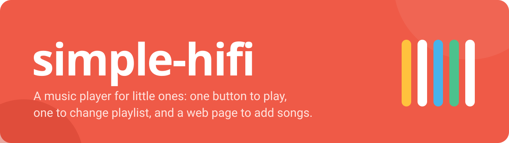
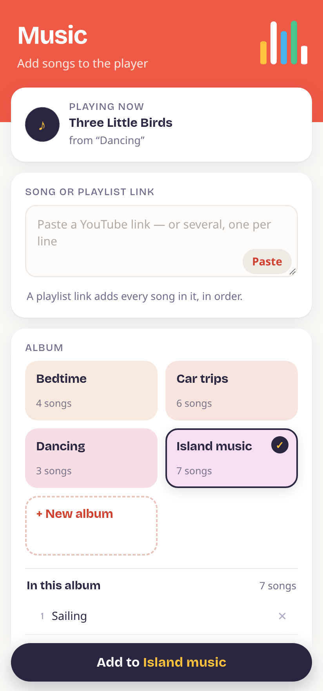
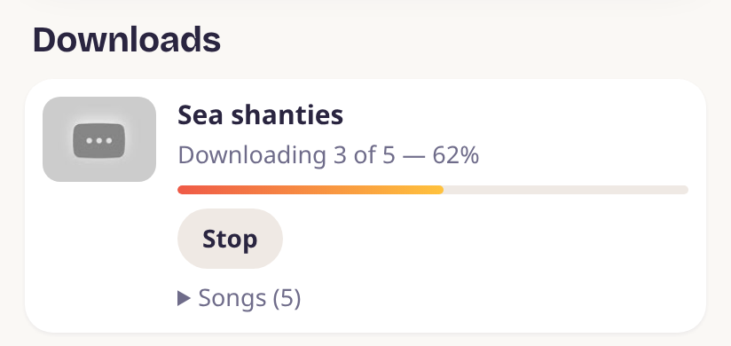
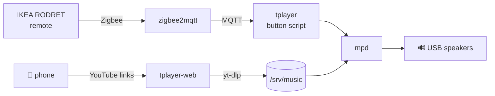

<p align="center">
  
</p>

<p align="center">
  <b>A Raspberry Pi, a pair of USB speakers and a two-button remote.</b><br>
  Small hands press a button and music plays. Grown-ups add songs from their phone.
</p>

<p align="center">
  
  
  
  
</p>

---

## 🎵 What it does

| | |
|---|---|
| **Top button** | Play / pause. Press twice quickly for the next song. |
| **Bottom button** | Next playlist. Each playlist starts again where it was left. |
| **The web page** | Paste or share YouTube links, pick an album, and the Pi downloads the songs into it. |

Each folder in `/srv/music` is a playlist. Playlists play in name order and loop, so `1-bedtime`, `2-dancing`, `3-car-trips` come round in that order.

<table>
  <tr>
    <td width="45%"></td>
    <td>
      <h3>The web page</h3>
      <ul>
        <li><b>Playing now</b>: what the speakers are playing.</li>
        <li><b>Paste</b> one link, several, or a whole playlist.</li>
        <li><b>Albums</b> show their songs; remove a song with two taps.</li>
        <li><b>Share</b> from the YouTube app: install the page on Android and it shows up in the share menu.</li>
        <li><b>Downloads</b> run one at a time, can be stopped, and failed ones try again by themselves (hourly, backing off per song).</li>
      </ul>
      
    </td>
  </tr>
</table>

## 🧰 What you need

| Part | Notes |
|---|---|
| Raspberry Pi 3 | The board it is built and tested on. |
| microSD card | Big enough for the OS and your music. |
| USB speakers | Plugged into the Pi's USB. |
| Sonoff ZBDongle-E | The Zigbee USB stick. |
| IKEA RODRET | The two-button remote. |
| A Mac | Only to flash the card (see *No Mac?* below). |

## 🔧 How it fits together



All of it runs on the Pi as systemd services. The web page is one Python file with no dependencies beyond the standard library. `yt-dlp` updates itself every day.

## 🚀 Set up

**1. Fill in your settings** next to the scripts. Every one of these is git-ignored:

```bash
cp local.env.example local.env            # hostname, page title, who to ask for help
cp wifi.env.example wifi.env              # Wi-Fi name and password
cp extra-keys.pub.example extra-keys.pub  # optional: more ssh keys for the Pi
```

**2. Flash the card** on a Mac. The Pi then installs everything by itself on first boot:

```bash
./flash-mac.sh            # lists the external disks
./flash-mac.sh disk4      # flashes /dev/disk4 (asks you to confirm)
```

**3. Pair the remote.** ssh in and run `tplayer-pair`, then press the RODRET's pair button 4 times.

**4. Add music.** Copy it in over ssh, one folder per playlist:

```bash
rsync -av ~/kids-music/ you@simple-hifi.local:/srv/music/
```

or open `http://simple-hifi.local:8090/` and paste some links.

> **No Mac?** Flash Raspberry Pi OS Lite (32-bit) any way you like, copy this folder onto the Pi, and run `sudo ./setup.sh`. It is safe to run again.

## ⚙️ Your settings

| File | What it holds |
|---|---|
| `local.env` | `PI_HOST` (the Pi's name on your network), `PLAYER_TITLE` (the page's name), `CONTACT_NAME` (who error messages say to ask), `PUBLIC_HOST` (a label for the public address) |
| `wifi.env` | `WIFI_SSID`, `WIFI_PASS` |
| `extra-keys.pub` | More ssh public keys that may log in |
| `cloudflared.token` | A Cloudflare Tunnel token, to reach the page from outside your home |

## 🌍 Reach the page from anywhere (optional)

Make a Cloudflare Tunnel that sends your hostname to `http://localhost:8090`, and put a Cloudflare Access login in front of it. Save the tunnel's token as `cloudflared.token`. `flash-mac.sh` copies it onto the card, and `setup.sh` installs it (readable by root only) and deletes the copy on the card. The Pi needs no static IP and no open ports.

## 💾 Reflash without losing anything

```bash
./flash-mac.sh --save     # copy the music and settings off the running Pi
./flash-mac.sh disk4      # flash; the settings go onto the card, the music goes back over ssh
```

The remote stays paired: the Zigbee network key and paired devices are restored before zigbee2mqtt starts. The script refuses to erase a card that holds a player when it has no backup (`SKIP_SAVE=1` overrides).

## 🩺 Good to know

- **32-bit, on purpose.** Under a 64-bit kernel, a Pi 3's USB driver loses its fast interrupt (FIQ). USB audio then drops out whenever the CPU is busy, such as during a download ([raspberrypi/linux#3795](https://github.com/raspberrypi/linux/issues/3795)). `setup.sh` also sets `dwc_otg.speed=1` (USB full speed), which fixed it on a 64-bit install.
- **Downloads never starve the music.** They run at idle priority on cores 1–3 with a memory cap. mpd keeps a 2-second buffer.
- **Logs:** `journalctl -u zigbee2mqtt -u tplayer -u tplayer-web -u mpd -f`, and button presses in `/var/log/tplayer.log`.

## 🧪 Tests

```bash
cd web && python3 -m unittest test_tplayer_web
```

They use a fake `yt-dlp` and a fake mpd, so they run anywhere.
